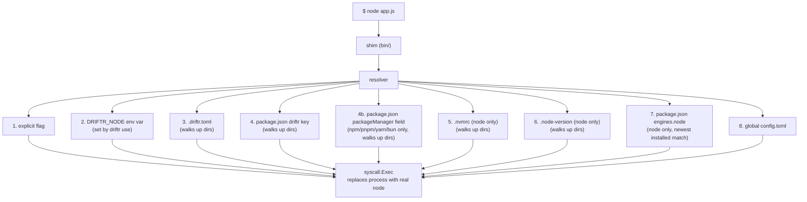

<p align="center">
  
</p>

<h1 align="center">Driftr</h1>

<p align="center">
  <strong>Fast JavaScript toolchain versioning without the friction.</strong>
</p>

<p align="center">
  A lightweight JavaScript toolchain manager built for speed and simplicity.<br>
  The spiritual successor to <a href="https://github.com/volta-cli/volta/issues/2080">Volta</a>, made for developers by developers.
</p>

<p align="center">
  <a href="https://github.com/StackMade/Driftr/actions/workflows/ci.yml"></a>
  <a href="https://codecov.io/gh/StackMade/Driftr"></a>
  <a href="go.mod"></a>
  <a href="https://github.com/StackMade/Driftr/releases/latest"></a>
  <a href="LICENSE"></a>
</p>

---

## Why Driftr?

[Volta is no longer maintained.](https://github.com/volta-cli/volta/issues/2080) If you liked Volta's "pin and forget" model -- where `node`, `pnpm`, and `yarn` just work without manual switching -- Driftr carries that torch forward.

Driftr is a new project. It doesn't have Volta's years of polish or fnm's community size. But it has a clean foundation, an honest design, and an active maintainer who actually uses it. If you're looking for something simple that does the job, give it a try. If it's missing something you need, [open an issue](https://github.com/StackMade/Driftr/issues) -- we're listening.

- **Multi-tool** -- manages Node.js, npm, pnpm, yarn, and bun from a single CLI; npm can be pinned on its own or left to the copy bundled with Node.js
- **Shim-based** -- `node`, `npm`, `npx`, `pnpm`, `pnpx`, `yarn`, and `bun` just work, resolved per-project or globally
- **Global packages** -- bins from `npm install -g` (`tsc`, `nest`, `corepack`) get shims and run under the Node.js version that installed them
- **Fast** -- near-zero overhead via `syscall.Exec` process replacement
- **Minimal** -- 2 external dependencies (cobra + toml), everything else is Go stdlib
- **Deterministic** -- explicit resolution chain: `DRIFTR_<TOOL>` (one shell, via `driftr use`) > project config > `package.json` (`driftr` key, then `packageManager` field for npm/pnpm/yarn/bun) > `.nvmrc` / `.node-version` (node) > `package.json` `engines.node` (node) > global default. Each directory is checked for every source before moving to its parent; the closest directory with a pin wins, except that `engines.node` only applies when no explicit node pin exists anywhere up the tree.
- **nvm-compatible pins** -- `.nvmrc` and `.node-version` are read as they are, including the `lts`, `lts/*` and `lts/<codename>` aliases
- **Secure** -- SHA256 and SHA-512 SRI checksum verification on every download
- **Simple** -- a handful of commands cover the entire workflow

## Install

### Homebrew (macOS and Linux)

```bash
brew tap StackMade/driftr
brew install driftr
```

After installing, run `driftr setup` — it generates the shims and configures your shell PATH automatically (writing to a universally-sourced rc file such as `~/.zshenv`). Restart your shell afterwards. See [docs/installation.md](docs/installation.md) for details and why PATH ordering matters on macOS.

### Quick Install (curl)

```bash
curl -fsSL https://raw.githubusercontent.com/StackMade/driftr/main/install.sh | sh
```

This downloads the latest release, verifies its checksum, and configures your PATH automatically. See [docs/installation.md](docs/installation.md) for all installation methods.

## Quick Start

```bash
# In a repo that already pins its tools, install what it asks for
driftr install

# Or install tools by name
driftr install node@22
driftr install npm@10    # optional: without it, npm is the one bundled with node
driftr install pnpm@9
driftr install yarn@1
driftr install bun@1

# Set global defaults
driftr default node@22.22.0
driftr default pnpm@9.15.0

# Pin a project (prompts for .driftr.toml or package.json on first use)
cd my-project
driftr pin node@22.22.0
driftr pin pnpm@9.15.0

# Everything just works
node -v   # resolves automatically
pnpm -v   # resolves automatically
```

## Commands

| Command | Description |
|---------|-------------|
| `driftr install [tool[@version]]` | Download and install a tool version (node, npm, pnpm, yarn, bun); with no argument, installs everything the current project pins; a bare tool name installs the latest; `node@lts` installs the newest LTS release, `node@lts/jod` a named LTS line |
| `driftr uninstall <tool@version>` | Remove an installed tool version |
| `driftr prune [--dry-run] [-y] [--tool <name>]` | Remove installed versions that neither the global default nor any recorded project uses |
| `driftr default <tool@version>` | Set the global default version for a tool |
| `driftr pin <tool@version>` | Pin a version to the current project (`.driftr.toml` or `package.json`) |
| `driftr pin <tool@version> --migrate` | Write this pin in the other format (`.driftr.toml` ↔ `package.json`), carrying every other tool pinned there, and remove the old config |
| `driftr pin --bump [tool...] [--major] [--dry-run]` | Move the project's existing pins to the newest release on their major line (`--major`: newest overall), in the file that holds each pin |
| `driftr use <tool@version>` | Print a shell snippet pinning a version for the current shell: `eval "$(driftr use node@24)"` |
| `driftr list [tool]` | List installed versions (defaults to node) |
| `driftr list --remote [tool]` | Browse available remote versions from nodejs.org, the npm registry, or bun's GitHub releases |
| `driftr outdated` | Compare the versions in use against the newest releases upstream |
| `driftr check [--exit-code]` | List every file that pins a tool for this directory, mark the one in use, and report pins that disagree or fall outside `engines.node` |
| `driftr which <tool>` | Show which binary would be executed and why; also takes a bin from a global npm install, e.g. `tsc` |
| `driftr run --node <ver> -- <cmd>` | Run a command under a specific Node.js version |
| `driftr setup` | Initialize Driftr, generate shims, and configure your shell PATH |
| `driftr cache clean` | Remove all cached downloads to free disk space |
| `driftr cache dir` | Print the cache directory path |
| `driftr self-update` | Update Driftr to the latest version |
| `driftr doctor [--fix]` | Check your Driftr installation for common problems; `--fix` repairs PATH and shims |
| `driftr node doctor` | Analyze the project's Node.js / pnpm dependency environment |
| `driftr node optimize [--install]` | Configure pnpm for shared dependency storage (idempotent) |
| `driftr node clean [--yes]` | Remove `node_modules` and prune the shared store (dry-run by default) |
| `driftr node report` | Report `node_modules` size and shared pnpm store size |
| `driftr completion <shell>` | Print a completion script for bash, zsh or fish |

All commands support `-v` / `--verbose` for detailed output including resolver tracing and checksum details. `driftr --version` prints the installed version.

Output is colorized when writing to a terminal: the logo above `driftr --help`, headings, command and flag names in `--help`, the `Error:` prefix, and the command each message suggests running next. Color is disabled automatically when stdout or stderr is piped/redirected, or when the [`NO_COLOR`](https://no-color.org/) environment variable is set.

### Shared dependency storage (`driftr node`)

Driftr does not replace pnpm/npm/yarn. The `driftr node` commands configure and
maintain pnpm's shared content-addressable store so dependencies are stored once
and reused across every project on the machine, instead of duplicated in each
`node_modules`.

```bash
driftr node doctor      # see current package manager + pnpm store configuration
driftr node optimize    # enable corepack, point pnpm at ~/.driftr/stores/pnpm,
                        # and turn on the global virtual store
driftr node report      # compare project node_modules size vs shared store size
driftr node clean       # dry-run: show what would be removed/pruned
driftr node clean --yes # remove node_modules, reinstall, prune orphaned packages
```

`optimize` is idempotent — already-correct settings are left untouched — and
requires pnpm (run `corepack enable` first if it is missing).

`clean --yes` reinstalls with the project's own package manager (from
`packageManager` or the lockfile, npm when neither is present) and checks that
it runs before removing anything.

### Remote version listing flags

```bash
driftr list --remote [tool]          # Show available versions (default: latest 30)
driftr list --remote --limit 10      # Limit output to 10 versions
driftr list --remote --limit 0       # Show all versions (can be 500+ for node)
driftr list --remote --pre pnpm      # Include pre-release versions (npm packages only)
```

Installed versions are marked with `●`, the active version with `>`, and the global default with `*`. Node.js LTS releases show their codename (e.g. `LTS: Jod`).

### Checking for updates (`driftr outdated`)

```bash
driftr outdated                # every managed tool
driftr outdated --tool node    # just one
driftr outdated --pre          # include npm pre-releases
driftr outdated --exit-code    # exit 1 when something is behind (CI)
```

The report shows the version each tool resolves to, the newest release on that
major line, the newest release overall, and for node the newest LTS. A tool
whose release source cannot be reached is reported as `unknown` and does not
stop the rest of the report. To move the project's pins to those releases, run
`driftr pin --bump` (see [usage](docs/usage.md)).

### Checking that pins agree (`driftr check`)

```bash
driftr check                # report, always exit 0
driftr check --exit-code    # exit 1 when a pin disagrees or cannot be read (CI)
```

A project can say `20` in `.nvmrc`, `22` in `.driftr.toml` and `>=24` in
`engines.node`. Driftr uses the first one it finds and nothing tells you the
others say something else. `driftr check` lists every source per tool, marks the
winner, and reports each one that disagrees with it, with the file to edit. It
reads files only and never touches the network.

## Shell Completions

```bash
# zsh
echo 'eval "$(driftr completion zsh)"' >> ~/.zshrc

# bash
echo 'eval "$(driftr completion bash)"' >> ~/.bashrc

# fish
driftr completion fish | source
```

## How It Works



The project sources (3 to 7) are read per directory: each directory is checked for every source before moving to its parent; the closest directory with a pin wins. `engines.node` is the exception: it is a fallback, used only when no explicit node pin exists anywhere up the tree.

Shims in `~/.driftr/bin/` intercept calls to `node`, `npm`, `npx`, `pnpm`, `pnpx`, `yarn`, and `bun`. The resolver determines the correct version, and `syscall.Exec` replaces the process with the real binary. Standalone tools (node, bun) are exec'd directly. Tools that need Node.js (pnpm, yarn, and a pinned npm) are exec'd as `node <tool-script>`. With no npm pinned, `npm` and `npx` run the copy bundled with the resolved Node.js.

## Documentation

| Document | Description |
|----------|-------------|
| [Installation](docs/installation.md) | Detailed install guide for macOS and Linux |
| [Usage](docs/usage.md) | Full CLI reference with examples |
| [Configuration](docs/configuration.md) | Global and project config format |
| [Architecture](docs/architecture.md) | Internal design and module overview |
| [Contributing](docs/contributing.md) | How to contribute to the project |

## Project Layout

```
~/.driftr/
  bin/              shims (node, npm, npx, pnpm, pnpx, yarn, bun)
  tools/
    node/           installed Node.js versions
    npm/            installed npm versions
    pnpm/           installed pnpm versions
    yarn/           installed yarn versions
    bun/            installed bun versions
  config/
    config.toml     global default settings
    projects        projects recorded by pin/install, checked by prune
  cache/            downloaded archives + binaries
  stores/pnpm/      shared pnpm store, used after driftr node optimize
```

## How Driftr Compares

| | **Driftr** | **nvm** | **Volta** | **fnm** | **mise** |
|---|---|---|---|---|---|
| Language | Go | Shell | Rust | Rust | Rust |
| Mechanism | Shims | Shell function | Shims | PATH via shell hook | PATH via shell hook (shims optional) |
| Cost model | ~5ms per tool call, nothing at shell startup | 200-500ms per shell startup | per tool call | per prompt / directory change | per prompt / directory change |
| Direct dependencies | **2** (cobra, toml) | 0 (shell) | 12 | 27 | 79 |
| Tools managed | node, npm, npx, pnpm, pnpx, yarn, bun | node + its bundled npm | node, npm, yarn; pnpm experimental (`VOLTA_FEATURE_PNPM=1`) | node only | node, pnpm, yarn, bun + hundreds of others |
| Reads `.nvmrc` / `.node-version` | Yes | Yes | No | Yes | Yes |
| Reads `engines.node` | Yes (installed versions) | No | No | Yes (default on) | No |
| Pin npm apart from node | Yes | No | Yes | No | Yes (`npm = "11"` in `mise.toml`) |
| Reads `packageManager` | Yes (npm, pnpm, yarn, bun) | No | No | Via corepack | Via corepack |
| Checksum verification | Always: SHA-256 (node, bun), SHA-512 SRI (npm, pnpm, yarn) | Yes, SHA-256 | [No](https://github.com/volta-cli/volta/issues/134) | No | Opt-in via `mise.lock` |
| Auto-install a missing pinned version | Yes, on shim call (prompt, or `auto_install = true`) | No | Yes | `--install-if-missing` | Yes |
| macOS / Linux | Yes | Yes | Yes | Yes | Yes |
| Windows | No | No | Yes | Yes | Yes |
| Latest release | v1.4.0 (2026-10-15) | v0.40.7 (2026-08) | v2.0.2 (**2024-12**) | v1.39.0 (2026-03) | v2026.9.1 (2026-09) |
| Maintained | Yes | Yes | **No** ([upstream says so](https://github.com/volta-cli/volta)) | Yes | Yes |
| Self-update | `driftr self-update` | `nvm` install script | No | Package manager | `mise self-update` |

Verified against upstream repositories and documentation on 2026-09-07. Dependency counts are
direct dependencies from each project's manifest, not the transitive tree. The Driftr cost figure is
the measured gap between running `~/.driftr/bin/node -v` and calling the real `node` binary on an
Apple Silicon Mac. It is per-call overhead, so you pay it when you run a tool and never when you
open a shell.

**When to choose Driftr**: You want a shim-based manager for Node.js, npm, pnpm, yarn and bun that behaves the way Volta did: pin a version to a project, and the tools follow. Driftr adds nothing to your shell startup, so the same pins hold in scripts, cron jobs and CI without an `activate` step. It checks the checksum of every download before unpacking it, ships with two library dependencies, and `driftr node` can point pnpm at one shared store instead of a separate `node_modules` copy per project.

**When to choose something else**: fnm if you need Windows. mise if you want one tool for Node, Python, Ruby and everything else; Volta's own README now sends people there. nvm if it already works for you and shell startup time doesn't bother you.

## Requirements

- macOS or Linux
- `curl` or `wget` (for the install script)
- Internet access (to download releases from nodejs.org, GitHub, and the npm registry)
- Go 1.27+ (only if building from source)

## About

<a href="https://stackmade.pl">
  <picture>
    <source media="(prefers-color-scheme: dark)" srcset="./assets/stackmade-logo-on-dark.svg">
    
  </picture>
</a>

Built by [StackMade](https://stackmade.pl) - a family of small, focused tools shipped as
code-first products.

Maintained by [Krzysztof Słomka](https://slomka.pro), software architect specializing in fintech,
distributed systems and event-driven architectures.

## License

MIT

## Contributing

See [docs/contributing.md](docs/contributing.md) for guidelines on how to contribute.
