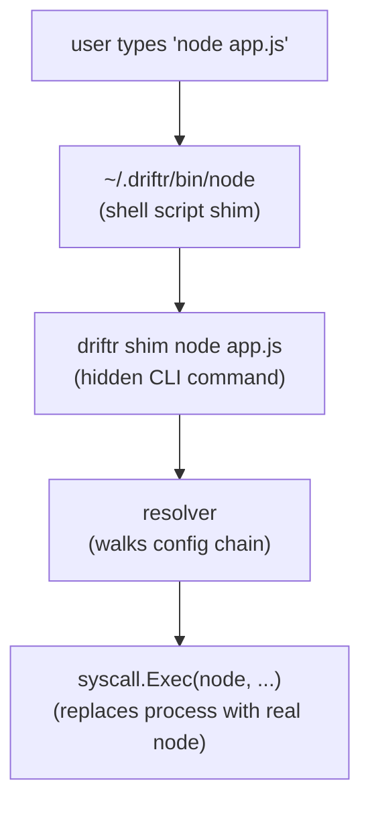
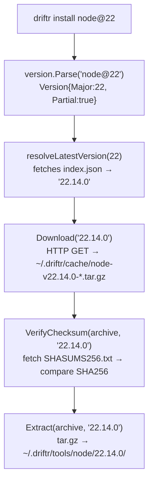
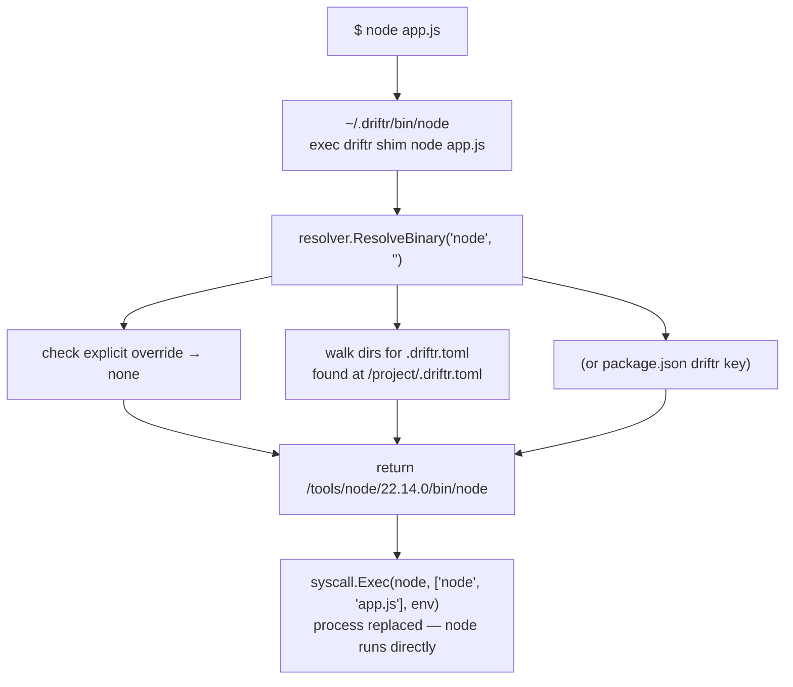

# Architecture

This document describes Driftr's internal design for contributors and anyone curious about how it works.

## Overview

Driftr is a shim-based toolchain manager. When you type `node`, `pnpm`, `yarn`, or `bun`, a lightweight shim intercepts the call, resolves the correct version, and replaces itself with the real binary using `syscall.Exec`. The entire resolution happens in single-digit milliseconds.

Standalone tools (node, bun) are exec'd directly. Tools that need Node.js to run (pnpm, yarn, and npm when it is pinned) are exec'd as `node <tool-script>`.



## Module Map

```text
cmd/driftr/
  main.go                   entry point; runs shim calls on a fast path before cobra

internal/
  cli/                      cobra command definitions
    root.go                 root command, global flags, --version
    install.go              driftr install (one tool, or every project pin)
    uninstall.go            driftr uninstall, warns when the version is a default or pinned
    prune.go                driftr prune
    default.go              driftr default
    pin.go                  driftr pin, --migrate
    pin_bump.go             driftr pin --bump (shares release fetching with outdated.go)
    use.go                  driftr use
    list.go                 driftr list / ls, --remote
    outdated.go             driftr outdated
    check.go                driftr check
    which.go                driftr which
    run.go                  driftr run
    setup.go                driftr setup
    doctor.go               driftr doctor and its checks
    cache.go                driftr cache clean / dir
    update.go               driftr self-update, PATH migration after the update
    node_cmd.go             driftr node (parent of the commands below)
    node_doctor.go          driftr node doctor
    node_optimize.go        driftr node optimize
    node_report.go          driftr node report
    node_clean.go           driftr node clean
    parse.go                tool@version argument parsing
    shim_cmd.go             driftr shim (hidden, called by shim scripts), auto-install prompt

  config/                   configuration management
    global.go               ~/.driftr/config/config.toml read/write
    projects.go             ~/.driftr/config/projects: directories prune checks
    project.go              .driftr.toml read/write + directory walk
    packagejson.go          package.json: driftr key, packageManager, engines.node
    nvmrc.go                .nvmrc reading, shared version-file parser
    nodeversion.go          .node-version reading

  installer/                tool installation pipelines
    node.go                 Node.js: resolve → download → verify SHA256 → extract
    registry_install.go     npm, pnpm, yarn: resolve → download from npm registry → verify SRI → extract
    npm.go, pnpm.go, yarn.go  per-tool entry points into registry_install.go
    bun.go                  bun: resolve → download from GitHub releases → verify SHA256 → extract
    registry.go             npm registry client: version resolution, tarball download, SRI verification
    registry_extract.go     tarball extraction for npm registry packages
    download.go             HTTP download with caching and progress reporting
    extract.go              tar.gz extraction with path sanitization
    zip.go                  zip extraction for bun release assets, sandboxed with os.Root
    checksum.go             SHA256 verification against SHASUMS256.txt

  resolver/                 version resolution engine
    resolver.go             generic resolution: ResolveTool(), ResolveBinaryFull() with dual resolution
    pins.go                 every pin a project holds, for install, outdated, check, prune and pin --bump

  shim/                     shim script generation
    shim.go                 creates shell scripts in ~/.driftr/bin/ (node, npm, npx, pnpm, pnpx, yarn, bun, package bins)

  process/                  process execution
    exec.go                 syscall.Exec (replace) and exec.Command (child)

  platform/                 OS and architecture abstraction
    platform.go             paths, directories, OS/arch detection, toolBinaryMap

  version/                  version string parsing
    version.go              semver parsing with partial version, tool@ prefix and LTS alias support
    range.go                semver ranges for engines.node

  pathsetup/                shell PATH configuration
    pathsetup.go            picks the rc file per shell, writes the PATH line and precedence guard

  nodeenv/                  support for driftr node
    pkgmgr.go               detects a project's package manager
    pnpm.go                 pnpm and corepack calls
    runner.go               external command runner, swapped for a fake in tests
    diskusage.go            directory sizes for node_modules and the store

  ioutil/                   terminal and file helpers
    color.go                colored output, off for NO_COLOR or non-terminal output
    terminal.go             TTY detection (terminal_darwin.go, terminal_linux.go per OS)
    progress.go             download progress on stderr
    copy.go                 file copy and atomic write, used for shims

  updater/                  self-update mechanism
    updater.go              checks GitHub releases, downloads and replaces binary
```

## Key Design Decisions

### Shim Architecture

Shims are simple shell scripts:

```sh
#!/bin/sh
exec "/usr/local/bin/driftr" shim node "$@"
```

The baked path is the path `driftr` was invoked with (`os.Executable()`), **not** the symlink-resolved target. This matters for package-manager installs: Homebrew exposes a stable symlink (`/opt/homebrew/bin/driftr`) pointing at a version-pinned file (`.../Cellar/driftr/0.11.1/bin/driftr`). Baking the resolved path would dangle every shim on the next `brew upgrade`; baking the stable symlink survives upgrades.

Shims exist for `node`, `npm`, `npx`, `pnpm`, `pnpx`, `yarn`, and `bun`. The `exec` replaces the shell process with `driftr`, and then `driftr` uses `syscall.Exec` to replace itself with the real binary. This double-exec means:

- No child process management
- Exit codes pass through natively
- stdin/stdout/stderr are preserved
- Signal handling is handled by the OS
- Near-zero latency overhead

There are three execution modes:

1. **Direct exec** (node, bun, and the npm bundled with node): `syscall.Exec(tool-binary, args, env)`
2. **Node-wrapped exec** (pnpm, yarn, pinned npm): `syscall.Exec(node, [yarn.js, args...], env)` — because these are JS scripts that need Node.js to run. The Node version is co-resolved from the same config.
3. **Package bin exec** (`tsc` after `npm install -g typescript`): every name in a Node.js version's `bin/` that is not one of Driftr's own tools gets a shim. The resolver picks the Node.js version that has the bin, preferring the one the project resolves to, and prepends that version's `bin/` to `PATH`, so the bin's `#!/usr/bin/env node` line finds the node it was installed with.

The shim dir comes first on `PATH`, so a package shim could silently replace a command that already worked. On every call it first looks for the same name on `PATH` outside `~/.driftr` and, if it finds one, execs that instead. Deciding this per call rather than when the shims are written keeps the answer tied to the `PATH` of the call: a refresh started from a script with a minimal `PATH` cannot plant a shim that later shadows a Homebrew install in an interactive shell. A package bin gets no shim at all when a file that is not a driftr shim already has its name in `~/.driftr/bin/` (the driftr binary can live there).

`~/.driftr/bin/.driftr-version` records the driftr version that wrote the shims. Every invocation, shims included, compares it with its own version and regenerates the shims once when they differ, so an upgrade by any route updates them. That costs one small file read per call. Shims are written to a temporary file and renamed into place, because several processes may refresh at once right after an upgrade and a shell must never read a half-written shim.

One invocation does not exec: `npm` with `-g`, `--global` or `--location=global` runs as a child process, because the shims have to be regenerated after npm adds or removes bins. Its exit code is passed through.

### `DisableFlagParsing` on Shim Command

The hidden `driftr shim` command sets `DisableFlagParsing: true` in cobra. This is critical because tool arguments like `node -v` or `npm --version` must pass through untouched. Without this, cobra would consume flags like `-v` as Driftr's own `--verbose` flag.

### Resolution Chain

The resolver follows a strict priority order:

1. **Explicit** -- `--node` flag on `driftr run`
2. **Environment** -- `DRIFTR_NODE`, `DRIFTR_NPM`, `DRIFTR_PNPM`, `DRIFTR_YARN` or `DRIFTR_BUN`, set for one shell by `driftr use`
3. **Project** -- `.driftr.toml` found by walking up from `cwd`
4. **package.json** -- `driftr` key in `package.json`, same walk-up
5. **`packageManager`** -- npm, pnpm, yarn and bun only, the standard `packageManager` field in `package.json` (`"pnpm@9.15.0"`), same walk-up
6. **`.nvmrc`** -- node only, found by walking up from `cwd`
7. **`.node-version`** -- node only, found by walking up from `cwd`
8. **`engines.node`** -- node only, the standard `engines` object in `package.json`, same walk-up; used only when steps 3-7 find no node pin anywhere up the tree
9. **Global** -- `~/.driftr/config/config.toml`

The variable name is `DRIFTR_` plus the tool name in upper case, and only for tools Driftr knows, so an unrelated `DRIFTR_*` in the environment cannot steer resolution. Its value goes through the same partial-version matching as `driftr pin`, against installed versions only.

In each directory, `.driftr.toml` is checked before the `driftr` key in `package.json`, then the `packageManager` field (npm, pnpm, yarn and bun only), then `.nvmrc`, then `.node-version`, then `engines.node` (the last three node only). Each directory is checked for every source before moving to its parent, and the closest directory with a pin wins, regardless of format, with one exception: `engines.node` is a fallback. An explicit node pin in a parent directory beats an `engines.node` range below it, so a package in a monorepo, or a dependency running its install script, keeps the project's pin. Without one, the nearest `engines.node` wins.

`engines.node` holds a semver range rather than one version. Driftr matches it against the versions already installed and takes the newest one that fits. It makes no network call to do so, which keeps the shim path offline. See [Configuration](configuration.md#enginesnode) for the supported syntax.

An `.nvmrc` or `.node-version` holding an LTS alias (`lts`, `lts/*`, `lts/jod`) resolves against installed versions only. The shim path never reaches the network. `lts` and `lts/*` take the newest installed major listed in a small static table of LTS codenames in `internal/version`, which a line joins when it is promoted, so an even major that is still Current is never picked. A codename maps to its major through the same table; the install path reads codenames off the release index instead, so that table exists only for offline resolution.

Each tool resolves independently: `npm`/`npx` via npm's version, `pnpm`/`pnpx` via pnpm's version, `yarn` via yarn's version, and `bun` via bun's own version. There is no system fallback — if no version is configured, Driftr returns an actionable error. The one exception is npm: with no npm configured at any level, `npm` and `npx` run the copy bundled with the resolved Node.js version, which is what they did before npm could be pinned. That costs the same second config walk pnpm and yarn already pay.

A pinned npm runs as `node npm-cli.js`. npm takes its global prefix from the node binary running it, so `npm install -g` lands in that Node.js version's directory either way, and package bin shims keep working.

### Partial Version Resolution

Partial versions (e.g. `node@22`, `pnpm@9`) are resolved to the latest matching release:

- **Node.js**: queries `nodejs.org/dist/index.json`
- **npm/pnpm/yarn**: queries the npm registry at `registry.npmjs.org/<package>`
- **bun**: queries the GitHub releases API for `oven-sh/bun` and reads the version out of each `bun-v<version>` tag

### Checksum Verification

| Tool    | Method                                            |
|---------|---------------------------------------------------|
| Node.js | SHA256 against `SHASUMS256.txt` from nodejs.org   |
| npm     | SHA-512 SRI integrity from npm registry metadata  |
| pnpm    | SHA-512 SRI integrity from npm registry metadata  |
| yarn    | SHA-512 SRI integrity from npm registry metadata  |
| bun     | SHA256 against the `SHASUMS256.txt` published with the release |

On failure, the cached archive is deleted so the next attempt re-downloads.

### Archive Extraction

Entries are unpacked through `os.Root`, so the kernel refuses any write that would
leave the version directory and refuses to follow a symlink out of it. Symlinks get one
check on top of that: a link whose target resolves outside the version directory is
rejected and the install fails. `os.Root` would keep such a link from doing damage
during extraction, but the link survives into the installed tree, where npm, a
postinstall script or the user's own tooling reads it without any sandbox. Links that
stay inside — `bin/npm -> ../lib/node_modules/npm/bin/npm-cli.js`, which every Node.js
archive ships — are created as-is.

### Partial Install Cleanup

If extraction fails (disk full, corrupt archive, interrupted), the partially extracted directory is removed via `os.RemoveAll`. This prevents a broken installation from appearing valid to the resolver.

## Data Flow: Install



## Data Flow: Shim Execution



## Platform Abstraction

The `platform` package translates between Go's `runtime.GOOS`/`runtime.GOARCH` and Node.js distribution naming:

| Go | Node.js dist |
|----|-------------|
| `darwin` | `darwin` |
| `linux` | `linux` |
| `windows` | `win` |
| `amd64` | `x64` |
| `arm64` | `arm64` |

Archive format is `.tar.gz` on Unix and `.zip` on Windows (future). Binary paths differ by OS (`bin/node` vs `node.exe`).

## Dependencies

Driftr uses minimal external dependencies:

| Package | Purpose |
|---------|---------|
| `github.com/spf13/cobra` | CLI framework |
| `github.com/BurntSushi/toml` | TOML config parsing |

Everything else uses the Go standard library: `net/http` for downloads, `crypto/sha256` for checksums, `archive/tar` + `compress/gzip` for extraction, `syscall` for exec.
